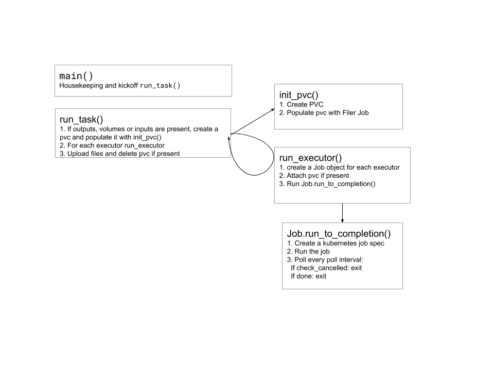

# Taskmaster

The taskmaster runs one TES task in Kubernetes. The TESK API starts one
taskmaster per task, as a Kubernetes job, and passes it the task as JSON: the
executors already converted to Kubernetes job specs, and the task's inputs,
outputs, volumes and resources.

## What it does

1. If the task has inputs, outputs or volumes, the taskmaster creates a
   persistent volume claim (PVC) of the task's disk size
   (`resources.disk_gb`) for them. If it has inputs, it then runs the
   [filer](filer.md) as a job (`<task>-inputs-filer`) that downloads them
   onto that volume.
2. It runs the executors, one after another, each as a job with the task's
   volume mounted. If an executor has resource requests but no limits, the
   requests also become its limits.
3. If the task has outputs, it runs the filer again
   (`<task>-outputs-filer`) to upload them. It then deletes the PVC, if
   there is one. Volumes need no filer: their directories on the PVC are
   created when the executors start, and their contents aren't uploaded.

The taskmaster polls each job until it completes. If a job doesn't complete,
the taskmaster stops without running the remaining jobs, deletes the PVC, and
exits with code 0. The TESK API derives the task's state from the jobs, not
from the taskmaster's exit code: an executor job that failed gives
`EXECUTOR_ERROR`, a filer job that failed `SYSTEM_ERROR`. So the taskmaster
keeps the jobs that failed, with the logs of their pods that ended.

The PVC is also deleted when the taskmaster stops on a cancelled task, also
one cancelled before the taskmaster started. Kubernetes frees the PVC's
storage only once no pod refers to it: until the task's jobs, and so their
pods, are deleted, the PVC stays `Terminating`, as after a task that
completed. The jobs stay until they are deleted, by hand or after a TTL
(see [Deleting finished tasks](#deleting-finished-tasks)). To keep the PVCs
of tasks that don't complete, e.g. to inspect their files, set
`KEEP_FAILED_PVC` to `true`; then delete them yourself. Tasks that
complete delete their PVC either way.

An error deleting the PVC is logged, also a request that times out (after
5 seconds to connect or 30 seconds to answer, per attempt of the Kubernetes
client); the taskmaster goes on as it would
(e.g. stops, or ends a completed task). An unexpected error of the
taskmaster itself fails its pod and keeps the PVC, as a retry of the pod
reuses it; if every retry fails, the PVC is left behind. An interrupt
(`SIGINT`, see below) keeps it too.

A job counts as failed when Kubernetes sets its condition `Failed`, or
`FailureTarget`, which Kubernetes 1.31 and later set first; it counts as
complete with `Complete` or `SuccessCriteriaMet`. Other conditions, e.g.
`Suspended`, leave the job running.

A pending pod whose containers can't start fails its job after
`--pod-timeout` seconds. That covers an image that can't be pulled
(`ErrImagePull`, `ImagePullBackOff`, `InvalidImageName`) and a broken
container configuration (`CreateContainerConfigError`, e.g. a missing secret
or ConfigMap), for init containers too. The timeout is measured from the
pod's start, or from its creation if it hasn't started. The taskmaster checks
the pods only once the job has been active for longer than `--pod-timeout`,
then at most once a minute, and stops checking once none of them is pending.
When a pod of the job fails, it checks again, so that a retry or the
replacement of an evicted pod that can't start times out too. A
pull error that comes after the pod has waited longer than `--pod-timeout`,
e.g. after a long pull of a large image, fails the job at the next check.

To fail the job, the taskmaster sets its
`activeDeadlineSeconds` to 1 second, so that Kubernetes deletes the job's
active pods and marks the job `Failed` with the reason `DeadlineExceeded`
(the pod's events show why it couldn't start). The taskmaster then handles it
like any job that failed, also after a restart of the taskmaster. If
Kubernetes hasn't marked the job within another `--pod-timeout`, the
taskmaster stops anyway and keeps the job. If the Kubernetes API rejects the
change (e.g., the taskmaster's role lacks `patch` on jobs), the taskmaster
deletes the job, as earlier releases did, and stops; after other errors, it
tries again at the next poll. Pods that are pending for other reasons, e.g.
waiting to be scheduled or pulling a large image, are queued and keep
waiting.

By default, a pod that the scheduler can't place waits forever, e.g. one
that asks for more CPU or memory than any node has: the task stays
`QUEUED`. With `TESK_MAX_QUEUE_SECONDS`, such a pod (its condition
`PodScheduled` is `False` with the reason `Unschedulable`) ends the task
once it has waited that many seconds since its creation. The taskmaster
logs an error with the job's name and the scheduler's message, e.g.
`Pod '...' of job 'task-1234-ex-00' wasn't scheduled within 3600 s: 0/3
nodes are available: 3 Insufficient cpu.`, and stops. The TESK API then
reports `SYSTEM_ERROR`:

- An executor's job is deleted, as its executor never ran: the task lacks
  an executor, which gives `SYSTEM_ERROR` rather than `EXECUTOR_ERROR`. This
  needs a TESK API release that derives the task state from all jobs of a
  task ([tesk-api#104](https://github.com/elixir-cloud-aai/tesk-api/issues/104));
  TESK API 1.1 and earlier report a task whose later executor was deleted
  as `COMPLETE`, so don't set `TESK_MAX_QUEUE_SECONDS` with them.
- If a pod of the executor's job ran or failed before (e.g. a retry, with
  `EXECUTOR_BACKOFF_LIMIT`, whose new pod can't be scheduled), the job is
  failed and kept instead, with the logs of the pods that ran: the TESK API
  reports `EXECUTOR_ERROR`.
- A filer's job is failed and kept, as for pods that can't start; a failed
  filer gives `SYSTEM_ERROR`.

If the Kubernetes API rejects the deletion, the job is failed and kept
instead; after other errors, including a request that times out after 30
seconds, the taskmaster tries again at the next poll, before anything else.

The pods are checked once the job has been active for longer than the
shorter of the max queue time and `--pod-timeout`, then at most once a
minute: with `TESK_MAX_QUEUE_SECONDS=600` and `--pod-timeout 240`, from
240 seconds on. So a task can end up to about a minute later than the max
queue time.

The max queue time covers the pods of the task's jobs only, not the
taskmaster's own pod: a task whose taskmaster can't be scheduled waits as
before. Neither does it cover pods that are never created, e.g. because a
`ResourceQuota` of the namespace is used up.

Executor jobs aren't retried (`backoffLimit: 0`) unless
`EXECUTOR_BACKOFF_LIMIT` (or the job) sets a limit, so that the state and logs
are those of the executor's only run. The limit also covers pods that
Kubernetes evicts, e.g. from a drained node: without retries, an evicted
executor fails. TESK's Helm chart sets `EXECUTOR_BACKOFF_LIMIT` from
`tesk.executorRetries` (2 by default); set it to 0 for single runs. The TESK
API creates executor jobs with the restart policy `Never`; with `OnFailure`,
Kubernetes would also restart failed containers within the pod.

To cancel a task, the TESK API labels the taskmaster's job and, if it runs,
its pod with `task-status: Cancelled`. The taskmaster checks for this label
before it creates the first job, before each executor and the outputs
filer, and while it polls: on its pod, through `/podinfo/labels` (a
Kubernetes downward API volume), and on its job, read from the Kubernetes
API (the job's name is in the pod's `job-name` label). A task that was
cancelled while its taskmaster's pod was pending, or before the pod existed,
has the label only on its job; its taskmaster stops before it creates any
job. When the taskmaster finds the label while a job runs, it deletes that
job, also one that it is failing, and stops; when it finds it between jobs,
it starts no other job.

Reading the job adds one `get` request per check, which needs `get` on
`jobs` for the taskmaster's service account (granted by the role of TESK's
Helm chart, `charts/tesk/templates/common/taskmaster-rbac.yaml`). Each
attempt of the request times out after 5 seconds to connect and 10 seconds
to answer; the Kubernetes client tries up to 4 times. If
the taskmaster can't read its job, also if the job doesn't exist, it logs an
error (once; later ones only with `--debug`) and checks again at the next
poll. Without `/podinfo/labels` (e.g. when run by hand), it doesn't check
for cancellation at all. If the taskmaster is interrupted (`SIGINT`), it
deletes the jobs it created.

## Options

The TESK API sets these in the taskmaster's job; they are listed for
development and debugging.

| Option | Default | Description |
|---|---|---|
| `JSON` (positional) or `-f`, `--file FILE` | | The task: as a JSON string, or as a file (gzipped if it ends with `.gz`; `-` for stdin). The TESK API passes `/jsoninput/JSON_INPUT.gz`. |
| `-n`, `--namespace` | `default` | Kubernetes namespace of the jobs and the PVC. |
| `-fn`, `--filer-name` | `eu.gcr.io/tes-wes/filer` | Image of the filer, without its tag. |
| `-fv`, `--filer-version` | `v0.1.9` | Tag of the filer image. |
| `-p`, `--poll-interval` | `5` | Seconds between polls of a job. |
| `-pt`, `--pod-timeout` | `240` | Seconds after which a pending pod that can't start fails its job (see above). |
| `-d`, `--debug` | off | Debug logging, also of the filer; without it, the taskmaster logs info messages, warnings and errors, the filer only errors. The job manifests in the log show URLs without queries and user info, and hide the FTP credentials. The HTTP and S3 libraries log only warnings and errors, also with `--debug`. |
| `--pull-policy-always` | off | Pull the filer image on every start (`imagePullPolicy: Always`). |
| `--localKubeConfig` | off | Use the local kubeconfig instead of the in-cluster configuration (for running the taskmaster outside a cluster). |

The defaults of `--filer-name` and `--filer-version` are outdated; the TESK
API always passes the filer image of its configuration.

## Environment variables

The TESK API passes each property `tesk.api.taskmaster.environment.<name>` of
its configuration to the taskmaster as the environment variable `<NAME>`
(upper case, dots as underscores); TESK's Helm chart sets them. The FTP
credentials come from a Kubernetes secret (see [Filer](filer.md#ftp)).

| Variable | Description |
|---|---|
| `EXECUTOR_BACKOFF_LIMIT` | Retries of each executor's job (`backoffLimit`); 0 if unset, unless the TESK API sets a limit in the job. |
| `FILER_BACKOFF_LIMIT` | Retries of each filer job (`backoffLimit`); Kubernetes' default if unset. |
| `FILER_HTTP_TIMEOUT` | Timeout of the filer's HTTP(S) requests (not FTP or S3), in seconds, for connecting and each read (see [Filer](filer.md#https)); passed on to the filer; 300 if unset. |
| `STORAGE_CLASS_NAME` | Storage class of the task's PVC; the cluster's default if unset. |
| `TESK_MAX_QUEUE_SECONDS` | Seconds after which a pod that the scheduler can't place ends the task with `SYSTEM_ERROR` (see [What it does](#what-it-does)), from 1 to 2147483647; unset or empty waits forever. Other values log an error and wait forever. |
| `TASK_TTL_SECONDS` | Seconds after which Kubernetes deletes the taskmaster's finished job, and with it the task's jobs (`ttlSecondsAfterFinished`; see [Deleting finished tasks](#deleting-finished-tasks)), from 0 to 2147483647; unset or empty keeps them. Other values log an error and set no TTL. |
| `KEEP_FAILED_PVC` | `true` keeps the PVC of a task that doesn't complete (a job failed, or the task was cancelled); unset, empty or `false` deletes it (see above). Other values log a warning and delete it. |
| `TESK_FTP_USERNAME`, `TESK_FTP_PASSWORD` | FTP credentials, passed on to the filer. |
| `TESK_FTP_HOSTS` | Hosts that the filer sends the FTP credentials to, passed on to the filer with them (see [Filer](filer.md#ftp)). |
| `NETRC_SECRET_NAME` | Name of a secret with a `.netrc` file (key `.netrc`), mounted into the filer for HTTP(S) and FTP credentials. |
| `HOST_BASE_PATH`, `CONTAINER_BASE_PATH`, `TRANSFER_PVC_NAME` | The shared volume of the `file:` protocol, passed on to the filer (see [Filer](filer.md#shared-volume-file)). |

The taskmaster also mounts the secret `aws-secret` into the filer, if it
exists, for S3 (see [Filer](filer.md#s3)).

## Deleting finished tasks

The filer and executor jobs that the taskmaster creates are owned by the
taskmaster's job (`ownerReferences`): when that job is deleted, Kubernetes
deletes them and their pods too. The taskmaster takes the job's name and
UID from its pod's labels (`batch.kubernetes.io/job-name` and
`batch.kubernetes.io/controller-uid`, or `job-name` and `controller-uid`
before Kubernetes 1.27); without them (e.g. outside a pod), the jobs get no
owner. The references don't block the owner's deletion
(`blockOwnerDeletion` isn't set), so they need no permission beyond
creating jobs. To delete a task by hand, delete its taskmaster's job with
`kubectl delete job <task>`, or through the API with the propagation
policy `Background` or `Foreground`: a `batch/v1` job deleted through the
API without a policy leaves the jobs it owns behind.

By default, nothing deletes the jobs. With `TASK_TTL_SECONDS` set to a
whole number of seconds, the taskmaster sets `ttlSecondsAfterFinished` on
its own job when it starts, also for a task that is cancelled before it
runs. Kubernetes then deletes the job that many seconds after it finished
(completed or failed), and with it the task's jobs and pods. This needs
`patch` on `jobs`; an error is logged, and the task runs without a TTL.

Some objects of a task aren't owned by its job, and stay:

- the ConfigMap with the task's JSON that the TESK API creates for the
  taskmaster (named after the task);
- a PVC that `KEEP_FAILED_PVC` keeps;
- the PVC of a task whose taskmaster failed unexpectedly (see
  [What it does](#what-it-does)).

TESK keeps no database: the TESK API reads tasks from their jobs. A task
whose jobs are deleted is gone: it no longer shows in `ListTasks`, and
`GetTask` doesn't find it. Pick a TTL long enough for the clients of the
TESK API (e.g. workflow engines) to read the final state and logs of their
tasks: hours rather than seconds. With `0`, a task disappears as soon as it
finishes. While Kubernetes deletes a task's jobs, which can take a moment,
the TESK API can report a task that completed as `SYSTEM_ERROR`, once some
of its executor jobs are gone; a long TTL makes it unlikely that clients
still read the task then.
